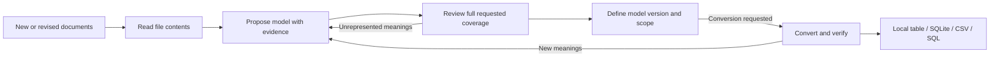
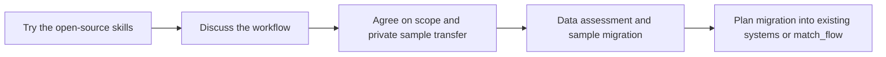

# axis_migration

An agent-guided tool that discovers industry- and company-appropriate data models
from document contents, reviews their coverage, and converts records with evidence.

**Read the files → propose a data model → review whether it can hold all requested
material → define the model → convert and verify the data.**

PDF, XLSX/XLS and PNG/JPEG contents provide evidence for document types, business
activities, fields, relationships and necessary functions. A stated business
purpose helps prioritize the model; its absence does not block discovery.
Counterparty classifications are proposed as company name → construction trade →
activity → specific operation → classification basis → source evidence, using
the [starter classification guide](construction-schema-design/references/classification-guide.md).
Supplied company mappings remain optional; proposals are distinct from defined
company policy. Requested conversion
produces traceable business data and a simple local, spreadsheet-like table.

An open-source project by [Axis Lab](https://github.com/NextSpace2025), supporting
the path from construction documents to reliable operational data and match_flow.

[One-command install](#install) ·
[Try the examples](#try-it) ·
[Request an initial data assessment](https://github.com/NextSpace2025/axis_migration/issues/new?title=Initial%20data%20assessment) ·
[About match_flow](#match_flow)

Construction procurement is the first worked example. Other document families
need their own evidenced concepts and row meanings. Preserve source information
before adapting it to an existing system's headers.

| Need | Skill | Result |
|---|---|---|
| Discover and review a document-based model | [construction-schema-design](construction-schema-design/SKILL.md) | Model evidence, ERD, fields, mappings, actual rows, coverage review and model decision |
| Convert using a defined model and coverage review | [construction-data-migration](construction-data-migration/SKILL.md) | Local SQLite and/or requested CSV/SQL, provenance and integrity findings |
| Match orders to statements across the supply chain | [construction-document-matching](construction-document-matching/SKILL.md) | Evidenced links, quantity/amount/party findings and open (unbilled) items |



Coverage review accounts for files, pages/sheets, regions and fields as
`typed_mapped`, `raw_only`, `unresolved`, or `excluded`, with targets or located
reasons. Raw storage does not prove business-model fit, and sample review does
not prove whole-folder coverage. Revise the model for uncovered meanings and
report the remaining scope honestly. A defined model can retain unknown source
values as null with issues; it does not require inventing data or approving every
header separately. Design-only requests end with the model and review.

After requested conversion, distinguish source-reading accuracy, semantic
mapping, source-internal conflicts, arithmetic and database integrity. Matching
totals alone cannot establish correct OCR or interpretation.

## What is included

- Instructions using the [Agent Skills format](https://agentskills.io/specification).
- Construction-specific quantity interpretation, row roles, source provenance,
  continuation-page evidence, and handling of unknown values.
- A [starter data model](construction-schema-design/references/design-contract.md)
  and fictional [source documents](construction-data-migration/assets/examples/example-order.txt),
  [SQL](construction-data-migration/assets/examples/example.sqlite.sql),
  companion CSV files, and a [validation walkthrough](construction-data-migration/assets/examples/validation-report.md).
- A standard-library-only public packaging script and executable fixture tests.

These are instructions and examples for a capable agent, not a hosted OCR
service or a universal document parser. The host needs suitable local file,
spreadsheet, PDF, or image-reading capabilities for the supplied source format.
The skill workflows need no package-specific API key, hosted data-processing
service, or environment variable.
Missing capabilities must be reported instead of simulated.

The first worked domain is procurement. Contracts, progress claims, labour,
equipment, ledgers, and inspections can reuse the process after their own
schema discovery. The purchase-order example is not a universal ERP schema.

For disorganized folders, the skills use
[content-first classification and table reconstruction](construction-schema-design/references/intent-to-table.md#content-first-classification-and-table-reconstruction):
extract located cells/text/image evidence, identify logical documents and table
regions, then propose and review common business columns before requested
conversion. Native spreadsheet cells take precedence over OCR. Folder/file
names are hints; content determines the classification, with conflicts and
uncertainty reported. Sources stay unchanged; rearranged records go into separate
outputs with links back to their original pages/cells. This is agent guidance,
not a newly bundled OCR engine or automatic file organizer.

## Current scope and next milestone

| Capability | Status |
|---|---|
| Document-based model proposals and coverage reviews | Agent skill workflow; source and host capabilities determine what can be verified |
| Evidence for necessary functions and target-system fit | Agent review using source records and supplied target evidence; not automatic ERP modification |
| Document interpretation and row rearrangement | Performed by the host agent with available tools; layout-dependent |
| SQLite table viewing and CSV/SQL downloads | Included local Python tool |
| Statement arithmetic, cumulative and open-item reconciliation | Included local Python tool (`scripts/reconcile.py`); linking decisions stay with the agent |
| Versioned package update, backup and rollback | Included explicit update tool |
| Duplicate-safe incremental ingestion and schema evolution | Skill guidance; reusable engine and end-to-end acceptance tests still planned |
| PO/statement matching and reconciliation | Agent skill workflow; links and findings support review, not payment approval |
| Upload UI, charts and ERP | Outside this release |

The next milestone is a repeatable accumulation workflow: the same source can be
rerun without duplicate rows; revised documents are distinguished from new ones;
header changes preserve earlier data; each value retains its source location.
Raw OCR text or JSON alone is not a successful migration. Unreadable or
unverified data must remain visibly separate from validated business records.

## Local workspace and result viewer

Selecting an input folder starts or resumes its private
`.axis_migration/record.md`. The agent records the company, scope, actual stage,
classification/model decisions, result links and remaining work, then appends
checkpoints. Later calls read it first, even with a different skill or host.
This metadata folder is excluded from source discovery; business reports and
exports keep the separate output location below. See the
[folder record guide](construction-schema-design/references/folder-record.md).

The skill installer below installs the skill directories. To also use the
viewer, package updater and output instructions, clone this repository:

```sh
git clone https://github.com/NextSpace2025/axis_migration.git
cd axis_migration
```

Ask the agent to read `AGENTS.md` and `output/agents.md`, inspect your selected
files, propose a model with actual source rows, and review the requested scope's
coverage. Once the model is defined, requested migration populates a fresh local
database. Output goes to the source folder's parent:
`INPUT.parent/output/INPUT.name/RUN_ID/`. Company configuration and data stay
outside this public repository.

```sh
python3 scripts/view_db.py /absolute/path/to/data.sqlite
```

Open the printed loopback URL and select the business table. The viewer is
read-only, requires Python 3.10+, and has no hosted API, CDN or telemetry.
An optional private JSON catalog adds a grouped dashboard, table-purpose and
interpretation guides, Korean column labels, and per-column meanings/units:

```sh
python3 scripts/view_db.py /absolute/path/to/data.sqlite --catalog /absolute/path/to/table_catalog.json
```

Keep company catalogs outside this repository. Original database fields, values,
and CSV/SQL export names remain unchanged; missing units are not inferred.
See the [2026-11-17 work log](docs/2026-11-17.md) for catalog fields and validation.

Document interpretation still depends on the host agent; using a cloud model
does not mean inference happens offline. This is a result viewer, not a browser
upload or independent OCR application.

## Package updates

Stop active migration jobs and the viewer before updating a cloned installation:

```sh
python3 scripts/update.py check
python3 scripts/update.py update
python3 scripts/update.py rollback --backup /path/to/axis_migration.backup-TIMESTAMP
```

Updates select stable `vMAJOR.MINOR.PATCH` Git tags, validate layout and VERSION,
back up the installation beside it, and preserve local `config/` and `output/`
data. External result directories and database schemas are not migrated.
`output/agents.md` follows the selected release. Other local edits remain in the
backup but are not merged. Restart the viewer and agent after updating.
Copied global skills are separate: refresh them using the installation command.
Use a trusted publisher; updates download executable code. Keep backups private.

## Install

Requires **Node.js 22.20+**, npm/npx, Git, and access to npm and GitHub.
Installation uses the [Vercel Labs skills CLI](https://github.com/vercel-labs/skills)
at the tested version **1.9.0**. Run these commands in your terminal.

Install all skills for **Codex, Claude Code, and Antigravity together**:

```sh
npx --yes skills@1.9.0 add NextSpace2025/axis_migration -g -a codex claude-code antigravity -s "*" --copy -y
```

Or install for one agent:

**Codex**

```sh
npx --yes skills@1.9.0 add NextSpace2025/axis_migration -g -a codex -s "*" --copy -y
```

**Claude Code**

```sh
npx --yes skills@1.9.0 add NextSpace2025/axis_migration -g -a claude-code -s "*" --copy -y
```

**Antigravity**

```sh
npx --yes skills@1.9.0 add NextSpace2025/axis_migration -g -a antigravity -s "*" --copy -y
```

`-g` makes the skills available across projects. `-s "*"` installs all skills
from this repository, and `--copy` includes their references, examples,
metadata, and licenses without relying on symlinks. `-y` skips installer prompts.
Rerunning the command refreshes same-named skills; **back up local edits before
reinstalling**, including a same-named skill installed from another source.

Default discovery locations:

| Agent | Global parent directory | Project-local parent directory | Reference |
|---|---|---|---|
| Codex | `~/.agents/skills/` | `.agents/skills/` | [Official OpenAI documentation](https://learn.chatgpt.com/docs/build-skills) |
| Claude Code | `~/.claude/skills/` | `.claude/skills/` | [Official documentation](https://code.claude.com/docs/en/skills) |
| Antigravity | `~/.gemini/config/skills/` | `.agents/skills/` | [Official documentation](https://antigravity.google/docs/skills) |

For a **project-local install**, run the same command from the project root
with `-g` omitted. For a preview without installation:

```sh
npx --yes skills@1.9.0 add NextSpace2025/axis_migration --list
```

Verify the global installation:

```sh
npx --yes skills@1.9.0 list -g -a codex claude-code antigravity
```

Start a new agent session if the skills do not appear. In Codex, invoke
`$construction-schema-design` or `$construction-data-migration`; in Claude
Code, use `/construction-schema-design` or `/construction-data-migration`.
Antigravity App/CLI also exposes skill-name slash commands; its IDE provides
skill discovery through Customizations. You can also name either skill in a
normal request.

For manual installation, copy each complete skill directory to the applicable
location above, retaining its `LICENSE`. Both skills work together; schema
design can run alone, and migration can use a supplied contract independently.
See the [CLI reference](https://github.com/vercel-labs/skills/blob/main/docs/commands.md)
for installation options. Agent runtime/OCR behavior still depends on the host
and is separate from checking that the skill files were installed correctly.

## Try it

Model proposal and coverage review:

> Use construction-schema-design to read the files in this folder and propose
> an industry-appropriate data model with evidence, English field names and
> actual sample rows. Review whether it can hold all requested material;
> identify raw-only, unresolved and excluded content. Record the model version
> and decisions. Preserve original labels and quantity roles. Do not convert yet.

Migration:

> Use construction-data-migration with this defined model and coverage review.
> Produce CSV and a standalone SQLite SQL file in a new output directory.
> Preserve source values and locations; separate reading, mapping, source
> conflicts, arithmetic and database findings. Report remaining coverage gaps.
> Validate the SQL in a disposable database and report what was verified.

SQL defaults to SQLite when no target is supplied. The example stores exact
decimals as canonical text; other targets need their own types and execution
checks. The [export contract](construction-data-migration/references/export-contract.md)
defines CSV null/backslash encoding and SQL safety boundaries.

## Verify and build a public release

Python 3.10+ is sufficient; the shipped tests and packager use only the standard
library. Run from this directory:

```sh
python3 -m unittest discover -s tests -v
python3 scripts/package_public.py --output dist/axis_migration.zip
```

The packager includes **only exact paths in [public-files.json](public-files.json)**.
It rejects private/hidden paths, symlinks, path traversal, archives, databases,
and duplicate entries. Existing output ZIPs are preserved; choose a new name
for another build. It logs timestamp, action, redacted input, result, and error.
The allowlist is a distribution boundary, not an automatic content-redaction
service: review any newly added files before adding them to the manifest.

`_private/` is a local-only area for legacy/company materials and is excluded by
`.gitignore`, `.gitattributes`, and the release packager. A local restructuring
may leave a verified legacy archive there. Publish the generated release or a
reviewed public-only checkout; do not upload a ZIP of the entire working folder.

## match_flow

**match_flow** is Axis Lab's SaaS ERP in development. Its core workflow matches
purchase orders with transaction statements so that construction businesses
can connect procurement records with ongoing operational management.

**axis_migration** supports the earlier model-discovery and readiness stage:
propose a model from actual documents, review its source coverage, and compare
necessary fields/functions with match_flow or another supplied target. Classify
the fit as direct mapping, evidenced transformation, proposed extension or
unresolved; do not infer unsupported features from an uninspected target.
Then perform requested conversion and integrity checks. CSV and SQL exports
remain useful with existing systems.
Import integration with match_flow is a future, separately specified step;
this repository contains the skills and examples, not the ERP or matching engine.

## Initial data assessment and migration consulting

Want to understand how your company's documents could become usable data?
Start with a scoped assessment before planning a full migration or ERP rollout.

An initial engagement can produce:

- A document/layout inventory and a clear definition of each record type.
- Evidence-backed headers, tables, relationships, necessary functions and mappings.
- A coverage review identifying represented, raw-only, unresolved and excluded
  information before the model is defined for conversion.
- A sample CSV/SQL conversion with traceable validation findings.
- A gap report covering missing values, inconsistent units, repeated records,
  and the decisions needed for a larger migration.
- Recommended next steps for your existing systems or a future match_flow rollout.

**[Request an initial data assessment](https://github.com/NextSpace2025/axis_migration/issues/new?title=Initial%20data%20assessment)**
by opening an issue with a non-confidential summary of your workflow, document
types, approximate volume, and desired outcome. This starts a scoping discussion;
delivery scope and commercial terms are agreed separately.

GitHub issues are public. Do not attach actual transaction statements, supplier
lists, prices, account details, credentials, or other company-confidential data.
Agree on a private transfer method with the maintainer before sharing source
documents. For a public example, use fictional or fully anonymized records.



## License

The public files listed in `public-files.json` are licensed under [MIT](LICENSE).
The license does not cover private legacy/company materials, user documents,
or third-party data. All bundled example names and transactions are fictional.
