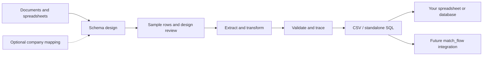
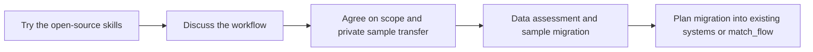

# axis_migration

Construction-focused AI skills for **schema design** and **document-to-database
migration**, with traceable CSV and standalone SQL exports.

An open-source project by [Axis Lab](https://github.com/NextSpace2025), supporting
the path from construction documents to reliable operational data and match_flow.

[One-command install](#install) ·
[Try the examples](#try-it) ·
[Request an initial data assessment](https://github.com/NextSpace2025/axis_migration/issues/new?title=Initial%20data%20assessment) ·
[About match_flow](#match_flow)

Start with purchase orders and transaction statements. Discover the source
structure, propose a reusable contract, then extract and validate the records.
Company classifications and ledger formats are optional local mappings.

| Need | Skill | Result |
|---|---|---|
| Discover headers, types, entities, and relationships | [construction-schema-design](construction-schema-design/SKILL.md) | ERD, field dictionary, source mapping, sample rows |
| Convert documents using an explicit contract | [construction-data-migration](construction-data-migration/SKILL.md) | CSV and/or SQL files, provenance, validation report |



## What is included

- English instructions using the [Agent Skills format](https://agentskills.io/specification).
- Construction-specific quantity interpretation, row roles, source provenance,
  continuation-page evidence, and handling of unknown values.
- A [starter data model](construction-schema-design/references/design-contract.md)
  and fictional [source documents](construction-data-migration/assets/examples/example-order.txt),
  [SQL](construction-data-migration/assets/examples/example.sqlite.sql),
  companion CSV files, and a [validation walkthrough](construction-data-migration/assets/examples/validation-report.md).
- A standard-library-only public packaging script and executable fixture tests.

These are instructions and examples for a capable agent, not a hosted OCR
service or a universal document parser. The host needs suitable local file,
spreadsheet, PDF, or image-reading capabilities for the supplied source format.
The skill workflows need no package-specific API key, hosted data-processing
service, or environment variable.
Missing capabilities must be reported instead of simulated.

The first worked domain is procurement. Contracts, progress claims, labour,
equipment, ledgers, and inspections can reuse the process after their own
schema discovery. The purchase-order example is not a universal ERP schema.

## Install

Requires **Node.js 22.20+**, npm/npx, Git, and access to npm and GitHub.
Installation uses the [Vercel Labs skills CLI](https://github.com/vercel-labs/skills)
at the tested version **1.9.0**. Run these commands in your terminal.

Install both skills for **Codex, Claude Code, and Antigravity together**:

```sh
npx --yes skills@1.9.0 add NextSpace2025/axis_migration -g -a codex claude-code antigravity -s "*" --copy -y
```

Or install for one agent:

**Codex**

```sh
npx --yes skills@1.9.0 add NextSpace2025/axis_migration -g -a codex -s "*" --copy -y
```

**Claude Code**

```sh
npx --yes skills@1.9.0 add NextSpace2025/axis_migration -g -a claude-code -s "*" --copy -y
```

**Antigravity**

```sh
npx --yes skills@1.9.0 add NextSpace2025/axis_migration -g -a antigravity -s "*" --copy -y
```

`-g` makes the skills available across projects. `-s "*"` installs both skills
from this repository, and `--copy` includes their references, examples,
metadata, and licenses without relying on symlinks. `-y` skips installer prompts.
Rerunning the command refreshes same-named skills; **back up local edits before
reinstalling**, including a same-named skill installed from another source.

Default discovery locations:

| Agent | Global parent directory | Project-local parent directory | Reference |
|---|---|---|---|
| Codex | `~/.agents/skills/` | `.agents/skills/` | [Official OpenAI documentation](https://learn.chatgpt.com/docs/build-skills) |
| Claude Code | `~/.claude/skills/` | `.claude/skills/` | [Official documentation](https://code.claude.com/docs/en/skills) |
| Antigravity | `~/.gemini/config/skills/` | `.agents/skills/` | [Official documentation](https://antigravity.google/docs/skills) |

For a **project-local install**, run the same command from the project root
with `-g` omitted. For a preview without installation:

```sh
npx --yes skills@1.9.0 add NextSpace2025/axis_migration --list
```

Verify the global installation:

```sh
npx --yes skills@1.9.0 list -g -a codex claude-code antigravity
```

Start a new agent session if the skills do not appear. In Codex, invoke
`$construction-schema-design` or `$construction-data-migration`; in Claude
Code, use `/construction-schema-design` or `/construction-data-migration`.
Antigravity App/CLI also exposes skill-name slash commands; its IDE provides
skill discovery through Customizations. You can also name either skill in a
normal request.

For manual installation, copy each complete skill directory to the applicable
location above, retaining its `LICENSE`. Both skills work together; schema
design can run alone, and migration can use a supplied contract independently.
See the [CLI reference](https://github.com/vercel-labs/skills/blob/main/docs/commands.md)
for installation options. Agent runtime/OCR behavior still depends on the host
and is separate from checking that the skill files were installed correctly.

## Try it

Schema discovery:

> Use construction-schema-design to inspect these purchase orders and
> transaction statements. Propose English CSV headers, an SQLite schema,
> source mappings, and sample rows. Preserve original labels and separate
> reported work area from billed quantity. No company classification map is
> available.

Migration:

> Use construction-data-migration with this schema and mapping. Produce CSV and
> a standalone SQLite SQL file in a new output directory. Preserve source
> values and locations; report unreadable values and arithmetic discrepancies.
> Validate the SQL in a disposable database and report what was verified.

SQL defaults to SQLite when no target is supplied. The example stores exact
decimals as canonical text; other targets need their own types and execution
checks. The [export contract](construction-data-migration/references/export-contract.md)
defines CSV null/backslash encoding and SQL safety boundaries.

## Verify and build a public release

Python 3.10+ is sufficient; the shipped tests and packager use only the standard
library. Run from this directory:

```sh
python3 -m unittest discover -s tests -v
python3 scripts/package_public.py --output dist/axis_migration.zip
```

The packager includes **only exact paths in [public-files.json](public-files.json)**.
It rejects private/hidden paths, symlinks, path traversal, archives, databases,
and duplicate entries. Existing output ZIPs are preserved; choose a new name
for another build. It logs timestamp, action, redacted input, result, and error.
The allowlist is a distribution boundary, not an automatic content-redaction
service: review any newly added files before adding them to the manifest.

`_private/` is a local-only area for legacy/company materials and is excluded by
`.gitignore`, `.gitattributes`, and the release packager. A local restructuring
may leave a verified legacy archive there. Publish the generated release or a
reviewed public-only checkout; do not upload a ZIP of the entire working folder.

## match_flow

**match_flow** is Axis Lab's SaaS ERP in development. Its core workflow matches
purchase orders with transaction statements so that construction businesses
can connect procurement records with ongoing operational management.

**axis_migration** supports the earlier data-preparation stage: understand the
documents, define a usable schema, convert records, and make data-quality gaps
visible. Its CSV and SQL exports remain useful with your existing systems.
Import integration with match_flow is a future, separately specified step;
this repository contains the skills and examples, not the ERP or matching engine.

## Initial data assessment and migration consulting

Want to understand how your company's documents could become usable data?
Start with a scoped assessment before planning a full migration or ERP rollout.

An initial engagement can produce:

- A document/layout inventory and a clear definition of each record type.
- Proposed CSV headers, database tables, relationships, and source mappings.
- A sample CSV/SQL conversion with traceable validation findings.
- A gap report covering missing values, inconsistent units, repeated records,
  and the decisions needed for a larger migration.
- Recommended next steps for your existing systems or a future match_flow rollout.

**[Request an initial data assessment](https://github.com/NextSpace2025/axis_migration/issues/new?title=Initial%20data%20assessment)**
by opening an issue with a non-confidential summary of your workflow, document
types, approximate volume, and desired outcome. This starts a scoping discussion;
delivery scope and commercial terms are agreed separately.

GitHub issues are public. Do not attach actual transaction statements, supplier
lists, prices, account details, credentials, or other company-confidential data.
Agree on a private transfer method with the maintainer before sharing source
documents. For a public example, use fictional or fully anonymized records.



## License

The public files listed in `public-files.json` are licensed under [MIT](LICENSE).
The license does not cover private legacy/company materials, user documents,
or third-party data. All bundled example names and transactions are fictional.
