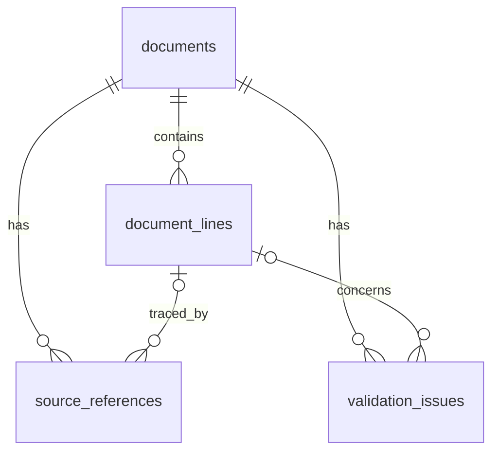

# Design contract and handoff

## Deliverables

Provide these in the requested format; a compact Markdown proposal is enough
unless the user asks for files:

1. Scope and model evidence: requested files, inspected layouts, actual reading
   capabilities/limits, observed industry/workflow and document families. Link
   each proposed entity, field, relationship and necessary function to located
   evidence. Distinguish observations, derivations and unconfirmed proposals.
2. ERD and table/column definitions with type, nullability, PK/FK, unit/currency
   meaning, and source-versus-derived status.
   Separate shared document metadata from document-type-specific detail headers
   and row meanings. Keep trade classification at three levels. For each
   subdivided source item, include located evidence for the independent fields,
   the original text, interpretation rule and missing-value handling; speculative
   attributes are not source-based headers.
3. Mapping rows: source file/layout, source label/location, target table/field,
   transformation, inherited-value source, and ambiguity or missing-value rule.
   For reconstructed layouts, include the logical document/region identity,
   content-based document type and evidence, reading method, contributing
   locations, and target row/fields. Locate filename/content conflicts and keep
   provisional classifications separate from confirmed ones.
4. Representative sample rows and validation rules, including arithmetic,
   detail/subtotal separation, source coverage, and relationship checks.
5. Coverage review and model decision: contract version, conversion scope,
   decision basis, unresolved information, exclusions and optional company
   mapping/version. Record later field/meaning changes as contract revisions.
6. If a target system is supplied, a field/function fit comparison based on its
   actual contract or implementation: `direct_map`, `transform_with_evidence`,
   `proposed_extension`, or `unresolved`. Record target evidence/version;
   uninspected capabilities are unverified, not absent. This does not authorize
   production changes or transaction matching.
7. A counterparty classification proposal using the
   [classification guide](classification-guide.md), including recurring source
   terms, mapping/version and decision status. Its leading columns are
   `company_name`, `major_category` (trade), `middle_category` (activity),
   `minor_category` (specific operation), `classification_basis`,
   `source_reference`, displayed as 회사명, 대분류(공종), 중분류, 소분류,
   분류기준, 원문 근거. Keep the reference buyer out of this counterparty table.

## Coverage review and model decision

Inventory every requested file and page/sheet. For each table/region and field
group, record the source location, observed meaning, proposed target field or
relationship, transformation/evidence, status and any issue/exclusion reason.
Split mixed regions so that one mapped field cannot hide an uncovered meaning.
Summarize file/layout coverage from these entries, including uninspected content.

| Status | Meaning | Effect on a coverage claim |
|---|---|---|
| `typed_mapped` | Business meaning has an explicit typed destination and mapping | Represented; source accuracy and later conversion still need validation |
| `raw_only` | Evidence retained but business meaning has no structured destination | Not represented in the business model; propose an extension or record the gap |
| `unresolved` | Content unread, unsupported, or its meaning/mapping is uncertain | Not established; locate the missing review or decision |
| `excluded` | Outside the stated conversion scope or a non-business/duplicate-copy region, with evidence and reason | Accounted for separately; never count as mapped or silently omit |

Do not assign a single mapped status to a partially reviewed file. Reading a
sample, saving OCR text, or obtaining matching totals does not establish full
coverage. Show inspected and remaining scopes separately. Explicitly requested
sampling can finish as a sample review, but cannot establish whole-folder fit.

Keep model state separate from data validity. A proposal becomes defined for a
stated scope when table/row meanings and mappings have no material ambiguity;
record the user selection, supplied contract or unambiguous combined-request
basis. Unknown source values can be represented by null plus an issue without
inventing a value. Missing model structure returns to design. Preserve and
report uncovered content; a partial conversion is not full requested coverage.
Model definition alone never authorizes an unrequested conversion.

For example, a fictional sheet has item detail in A1:H20 and payment/balance
history in J1:M20. Mapping the item columns while saving the rest as text is
`typed_mapped` for detail and `raw_only` for the ledger region, not full fit.
A second unopened sheet is `unresolved` even if the first sheet totals reconcile.

For SQL, state one target dialect. Honour a specified target. If the user asks
for a standalone SQL file without naming a database, propose SQLite and disclose
the choice; a known application database takes precedence. This is not a claim
of cross-dialect compatibility. For SQLite exact decimal values, canonical
decimal text is appropriate; use decimal arithmetic during validation.

Company mappings can provide target field names, category/name mappings,
source-specific unit aliases, or evidenced rounding rules. They are optional,
local inputs. Keep them separate from the public examples and record which
transformations were actually used.

## Starter model: purchase orders and transaction statements

This is a worked design, not a compulsory schema for all companies or domains.
The export example in the migration skill implements this model for SQLite.
Identifiers are export-local technical keys, not proof of a business match.

| Table | Grain and keys | Fields and logical types |
|---|---|---|
| `documents` | One observed document; `document_id TEXT PK` | `document_type TEXT`, `document_number TEXT?`, `document_date DATE?`, `supplier_name TEXT?`, `buyer_name TEXT?`, `project_name TEXT?`, `currency TEXT?`, `supply_amount DECIMAL?`, `tax_amount DECIMAL?`, `total_amount DECIMAL?` |
| `document_lines` | One source row; `line_id TEXT PK`, `document_id TEXT FK` | `line_number INTEGER`, `row_type TEXT`, `item_name TEXT?`, `specification TEXT?`, `work_area DECIMAL?` (m² only), `billed_quantity DECIMAL?`, `billed_unit TEXT?`, `unit_price DECIMAL?`, `amount DECIMAL?`, `source_category TEXT?`, `company_category TEXT?`, `raw_record TEXT` |
| `source_references` | One source location; `reference_id TEXT PK`, `document_id TEXT FK`, `line_id TEXT? FK` | `source_file TEXT`, `source_location TEXT`, `connection_evidence TEXT?` |
| `validation_issues` | One unresolved/check finding; `issue_id TEXT PK`, `document_id TEXT FK`, `line_id TEXT? FK` | `code TEXT`, `cause TEXT`, `resolution TEXT` |

`?` means nullable; all other columns are required. A line reference or issue
must belong to the same document as its referenced line. Require unique
`(document_id, line_number)` and positive line numbers. Example row types are
`detail`, `charge`, `deduction`, `subtotal`, `carry_forward`, `tax`, `total`, `note`.
Non-detail row roles stay identifiable and are excluded from detail sums.

`raw_record` preserves original row labels, strings, and blanks as JSON text.
For a normalized field derived from multiple cells, map every contributing
location and the transformation. A document-level source reference is required
even when no detail rows can be read. File names in this export are relative
source identifiers, not private absolute filesystem paths.

## Synthetic source and sample rows

All names, identifiers, dates, and numbers below are fictional.

Transaction statement `EX-ST-001`, dated `2030-04-15`, from
`Example Metal Works` to `Example Contractor`, project `Example Site A`,
currency `KRW` explicitly printed. Source: `example-statement.txt`.

| Source line | 품명 | 면적(㎡) | 청구수량 | 청구단위 | 단가 | 금액 |
|---|---|---:|---:|---|---:|---:|
| 1 | Panel processing | 4.5 | 6 | EA | 100 | 600 |
| 2 | Delivery charge | | | | | 50 |

The statement declares supply 650, tax 65, total 715. Row 1's reported area is
4.5 m² but its billed quantity is 6 EA. Row 2 has an amount with no arithmetic
basis. Do not fabricate quantity 1 or unit price 50 to make it checkable.

| line_id | document_id | row_type | work_area | billed_quantity | billed_unit | unit_price | amount | company_category |
|---|---|---|---:|---:|---|---:|---:|---|
| L-ST-1 | D-ST-1 | detail | 4.5 | 6 | EA | 100 | 600 | NULL |
| L-ST-2 | D-ST-1 | charge | NULL | NULL | NULL | NULL | 50 | NULL |

An independent fictional order `EX-PO-001` contains two identical-looking but
distinct numbered rows, each 2 SHEET × 300 = 600. Preserve both. It declares
supply 1200, tax 120, total 1320. No relationship to `EX-ST-001` is established.

## Design review before conversion

- Is every requested file/page/sheet accounted for, with reviewed fields/regions
  mapped or given a located raw-only, unresolved or excluded reason?
- Do entity/field/function proposals have evidence, and are optional company
  categories separate from document type, activity and pricing basis?
- Are parties, dates, quantity roles, units, and row roles unambiguous?
- Are supplied category/name mappings optional and traceable instead of guessed?
- Is the three-level classification proposal present even without a supplied
  company map, with raw text evidence and uncertain levels exposed separately?
- Do PK/FK and document/line ownership constraints prevent cross-document links?
- Are precision, SQL dialect, null/empty handling, and validation rules stated?
- Can the contract represent empty documents, charge-only rows, repeated real
  rows, split pages, and new columns without data loss?

Resolve material structural/mapping gaps for the conversion scope and record
the model version/decision before bulk conversion. Remaining source uncertainty
may be null plus a located issue; it must not be silently resolved to satisfy a
constraint. Raw-only or excluded content remains visible in partial results.
