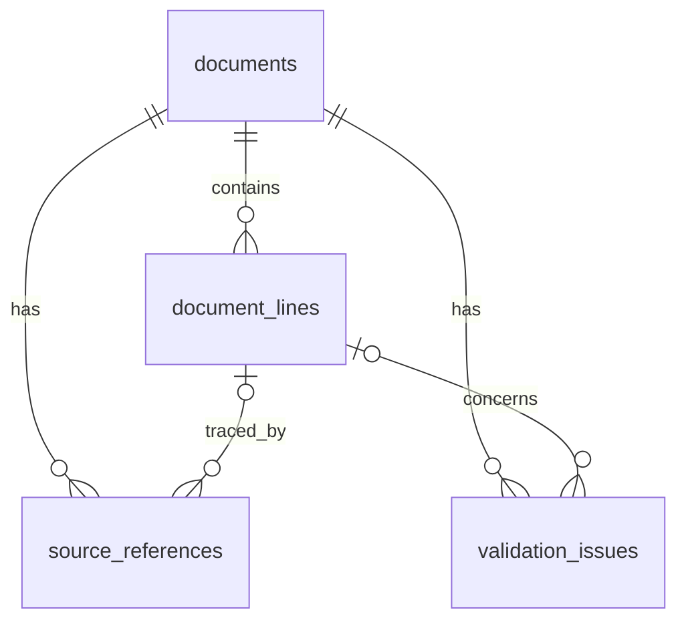

# Design contract and handoff

## Deliverables

Provide these in the requested format; a compact Markdown proposal is enough
unless the user asks for files:

1. Scope: document family, inspected layouts, table grain, and limitations.
2. ERD and table/column definitions with type, nullability, PK/FK, unit/currency
   meaning, and source-versus-derived status.
3. Mapping rows: source file/layout, source label/location, target table/field,
   transformation, inherited-value source, and ambiguity or missing-value rule.
4. Representative sample rows and validation rules, including arithmetic,
   detail/subtotal separation, source coverage, and relationship checks.
5. Contract version and optional company mapping/version. Record changes when
   a later layout adds fields or changes a field's meaning.

For SQL, state one target dialect. Honour a specified target. If the user asks
for a standalone SQL file without naming a database, propose SQLite and disclose
the choice; a known application database takes precedence. This is not a claim
of cross-dialect compatibility. For SQLite exact decimal values, canonical
decimal text is appropriate; use decimal arithmetic during validation.

Company mappings can provide target field names, category/name mappings,
source-specific unit aliases, or evidenced rounding rules. They are optional,
local inputs. Keep them separate from the public examples and record which
transformations were actually used.

## Starter model: purchase orders and transaction statements

This is a worked design, not a compulsory schema for all companies or domains.
The export example in the migration skill implements this model for SQLite.
Identifiers are export-local technical keys, not proof of a business match.

| Table | Grain and keys | Fields and logical types |
|---|---|---|
| `documents` | One observed document; `document_id TEXT PK` | `document_type TEXT`, `document_number TEXT?`, `document_date DATE?`, `supplier_name TEXT?`, `buyer_name TEXT?`, `project_name TEXT?`, `currency TEXT?`, `supply_amount DECIMAL?`, `tax_amount DECIMAL?`, `total_amount DECIMAL?` |
| `document_lines` | One source row; `line_id TEXT PK`, `document_id TEXT FK` | `line_number INTEGER`, `row_type TEXT`, `item_name TEXT?`, `specification TEXT?`, `work_area DECIMAL?` (m² only), `billed_quantity DECIMAL?`, `billed_unit TEXT?`, `unit_price DECIMAL?`, `amount DECIMAL?`, `source_category TEXT?`, `company_category TEXT?`, `raw_record TEXT` |
| `source_references` | One source location; `reference_id TEXT PK`, `document_id TEXT FK`, `line_id TEXT? FK` | `source_file TEXT`, `source_location TEXT`, `connection_evidence TEXT?` |
| `validation_issues` | One unresolved/check finding; `issue_id TEXT PK`, `document_id TEXT FK`, `line_id TEXT? FK` | `code TEXT`, `cause TEXT`, `resolution TEXT` |

`?` means nullable; all other columns are required. A line reference or issue
must belong to the same document as its referenced line. Require unique
`(document_id, line_number)` and positive line numbers. Example row types are
`detail`, `charge`, `deduction`, `subtotal`, `carry_forward`, `tax`, `total`, `note`.
Non-detail row roles stay identifiable and are excluded from detail sums.

`raw_record` preserves original row labels, strings, and blanks as JSON text.
For a normalized field derived from multiple cells, map every contributing
location and the transformation. A document-level source reference is required
even when no detail rows can be read. File names in this export are relative
source identifiers, not private absolute filesystem paths.

## Synthetic source and sample rows

All names, identifiers, dates, and numbers below are fictional.

Transaction statement `EX-ST-001`, dated `2030-04-15`, from
`Example Metal Works` to `Example Contractor`, project `Example Site A`,
currency `KRW` explicitly printed. Source: `example-statement.txt`.

| Source line | 품명 | 면적(㎡) | 청구수량 | 청구단위 | 단가 | 금액 |
|---|---|---:|---:|---|---:|---:|
| 1 | Panel processing | 4.5 | 6 | EA | 100 | 600 |
| 2 | Delivery charge | | | | | 50 |

The statement declares supply 650, tax 65, total 715. Row 1's reported area is
4.5 m² but its billed quantity is 6 EA. Row 2 has an amount with no arithmetic
basis. Do not fabricate quantity 1 or unit price 50 to make it checkable.

| line_id | document_id | row_type | work_area | billed_quantity | billed_unit | unit_price | amount | company_category |
|---|---|---|---:|---:|---|---:|---:|---|
| L-ST-1 | D-ST-1 | detail | 4.5 | 6 | EA | 100 | 600 | NULL |
| L-ST-2 | D-ST-1 | charge | NULL | NULL | NULL | NULL | 50 | NULL |

An independent fictional order `EX-PO-001` contains two identical-looking but
distinct numbered rows, each 2 SHEET × 300 = 600. Preserve both. It declares
supply 1200, tax 120, total 1320. No relationship to `EX-ST-001` is established.

## Design review before conversion

- Can every sampled source field be preserved or accounted for explicitly?
- Are parties, dates, quantity roles, units, and row roles unambiguous?
- Are category/name mappings optional and traceable instead of guessed?
- Do PK/FK and document/line ownership constraints prevent cross-document links?
- Are precision, SQL dialect, null/empty handling, and validation rules stated?
- Can the contract represent empty documents, charge-only rows, repeated real
  rows, split pages, and new columns without data loss?

Resolve material design gaps before bulk conversion. Remaining source
uncertainty may be represented as null plus a located issue; it must not be
silently resolved to satisfy a constraint.
